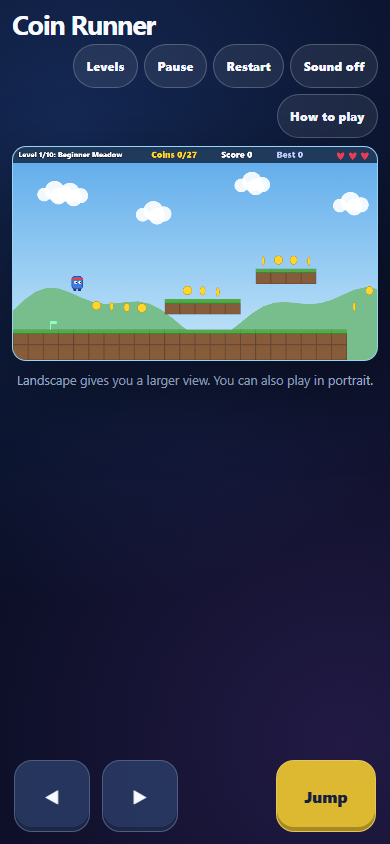

# Coin Runner

An original, code-drawn platform adventure with ten scrolling levels. The browser edition uses JavaScript, HTML5 Canvas, CSS and Web Audio. The Python desktop edition uses pygame-ce. Neither edition requires paid services or third-party artwork.

## Play locally

From the repository root:

```sh
python -m http.server 8000
```

Open **http://localhost:8000/docs/**. On Windows, `py` can replace `python`. Use HTTP rather than opening the HTML file directly because the browser game uses JavaScript modules. The web game requires no packages or build step.

For the separate desktop edition (Python 3.10+):

```sh
python -m pip install -r requirements.txt
python platformer.py
```

## Features

- Ten distinct tile maps, collectible coins, enemies, spikes, pits and clear finish flags.
- Variable-height jumps, jump buffering, coyote time and safe-ground recovery checkpoints.
- Browser moving platforms, cycling traps, moving hazards, snow momentum and smooth camera following.
- Three lives, enemy stomping, damage recovery, generated sounds and a saved best score.
- Start, pause, resume, restart, game over, level complete and final victory screens.
- Browser level selection, sequential unlocking, replay and local progress saving.
- Responsive presentation, large multitouch controls and mobile safe-area spacing.

## The ten levels

| Level | Name | Route and challenges |
| --- | --- | --- |
| 1 | Beginner Meadow | Original Sunny Meadow map; running, coins and introductory gaps. |
| 2 | Forest Adventure | Original Crystal Caves map; stepping platforms and enemies, with forest colors in the browser. |
| 3 | Mountain Path | Original Sky Islands map; a demanding elevated route, now with mountain colors. |
| 4 | Underground Cave | Low ceilings, tunnels, ledges and a moving overhead hazard. |
| 5 | Desert Journey | Separated dunes, four-tile gaps and moving assistance platforms. |
| 6 | Snowy Mountains | Alternating ledges and gaps; momentum requires earlier braking. |
| 7 | Haunted Castle | A lower corridor and hidden upper coin route, enemies and a cycling trap. |
| 8 | Sky Islands | Floating upper platforms, repeated gaps and vertical coin routes. |
| 9 | Lava Fortress | Gaps, spikes, a moving platform and timed flame traps. |
| 10 | Final Castle | A longer final gauntlet combining elevated paths, enemies and traps. |

The original three tile layouts are preserved exactly. Their display names/themes match the new progression; their original difficulty is retained. Every map has a safe start, coins, enemies and a flag. The desktop edition plays the same ten tile maps with its existing static physics and visuals. Moving platforms, timed hazards, ice physics, themed backgrounds and level selection are browser enhancements. Safe static routes remain available in the desktop maps. The existing enemy architecture has no boss system; the final stage uses a gauntlet rather than a boss encounter.

## Controls

| Action | Keyboard | Touchscreen |
| --- | --- | --- |
| Move | Left / A, Right / D | Hold the left or right arrow at bottom left |
| Jump | Space / Up / W; hold for height | Hold Jump at bottom right, together with movement |
| Pause / Resume | P / Escape | Pause above the game, then Resume |
| Restart level | Browser Restart button; desktop R while paused | Restart above the game or in the pause panel |
| Select unlocked level | Browser Levels button | Levels above the game |
| Sound | M or Sound button | Sound button |
| Help | Browser How to play; desktop H | How to play |

Pointer capture tracks each finger independently, including release outside a button, cancellation and lost capture. Pausing, opening a menu, hiding the page or losing focus clears held inputs. Control buttons suppress scrolling and touch gestures locally; browser zoom is not globally disabled. Snow retains physical momentum briefly after input is released.

Green pennants show recovery checkpoints. Cyan platforms move. Orange hazards cycle between a warning and an active phase. Reach the red flag to complete a stage. Coins give 10 points, enemies 100, completion 200 and collecting every coin adds 300. Score and remaining lives carry forward. Each completed flag restores one life, capped at three. Replaying an unlocked level starts a fresh run with three lives; Restart restores that level's entry score and lives.

## Progress

The browser saves unlocked levels and best score in `localStorage`, per browser and origin. It migrates the original browser best score. Invalid or unavailable storage falls back to playable in-memory progress. **Levels ? Reset progress** asks for confirmation before resetting browser progress. No personal data is stored. Desktop retains its existing `highscore.json` behavior.

## Browser compatibility and layout

Targets modern Android Chrome, iPhone Safari, Chrome, Edge and Firefox with Canvas, ES modules, Pointer Events, Web Audio and native dialogs. Landscape offers a larger play area; portrait remains playable with controls anchored near the bottom corners. The canvas retains its 12:7 aspect ratio and accounts for dynamic viewport height and safe areas. Sound may require an initial user gesture.

Headless Chrome checks cover desktop and phone viewport sizes, including multitouch. Real Android/iPhone devices, Safari/Firefox and sustained performance on physical mid-range phones have not been verified. The HUD becomes small on narrow portrait screens. Landscape is recommended. The original third map remains challenging, so the first three stages are not a perfectly smooth difficulty ramp.

## Deploy with GitHub Pages

Keep the existing static deployment: repository **Settings ? Pages ? Deploy from a branch**, choose the publishing branch and the **/docs** folder. All runtime paths are relative; no Node installation, backend, build process or API key is needed on the host. Only `docs/` is needed to serve the browser game. Publishing is a separate action; local checks do not push or deploy anything.

## Validation and development

```sh
python -m unittest -v
python tools/export_levels.py --check
node --test tests/browser.test.mjs
node --check docs/js/game.js
```

The Python suite tests maps, physics, collisions, scoring, recorded winning routes, UI, rendering and audio. The Node suite validates all maps/assets, input aliases and independent sources, pointer capture/cancellation, persistence, moving platforms, hazards, ice and recorded winning routes in the actual browser physics.

Optional real-browser integration checks require a locally installed Chrome/Edge and the test-only Python `websockets` package:

```sh
python -m pip install websockets
python tools/browser_smoke.py
```

This launches a temporary headless browser and local HTTP server, checks four viewport sizes, keyboard, two-finger movement/jump, cancellation, pause/restart, locks and winning routes, and writes `screenshots/browser-mobile.png`. It does not alter your normal browser profile.

Edit canonical tile definitions and browser feature metadata in `levels.py`, then export:

```sh
python tools/export_levels.py
python solver.py
node tools/solve_browser.mjs
```

The two solvers use their respective real physics and write recorded runs to `replays.json` and `tests/browser-replays.json`. Browser physics includes dynamic features and has separate recordings. Automated completion demonstrates a possible route, not that every route or collectible is reachable or that every human player will find the stages comfortable. The slower live Python solver check can be enabled with `RUN_SLOW_TESTS=1` (`$env:RUN_SLOW_TESTS = "1"` in PowerShell).

## Project structure

| File | Purpose |
| --- | --- |
| `docs/index.html`, `docs/css/style.css` | Browser entry, menus, responsive styling and controls |
| `docs/js/game.js` | Browser rendering, audio, camera and session flow |
| `docs/js/world.js` | Browser collisions, physics and dynamic features |
| `docs/js/input.js`, `docs/js/progress.js` | Multisource input and resilient browser saves |
| `docs/js/levels.js` | Generated browser maps; do not edit directly |
| `levels.py`, `tools/export_levels.py` | Canonical maps and browser exporter |
| `platformer.py`, `world.py` | Existing pygame interface and desktop physics |
| `solver.py`, `tools/solve_browser.mjs` | Real-physics route solvers |
| `test_platformer.py`, `tests/`, `tools/browser_smoke.py` | Automated validation |

## Screenshots

Browser portrait gameplay (captured by the integration check):



Original desktop edition (legacy level names/themes):


## Assets and licensing

Artwork consists of original shapes drawn in code; audio is synthesized at runtime. No Nintendo sprites, music or branding are included. The repository does not currently declare a source license; add an appropriate license before distributing it under specific terms.
